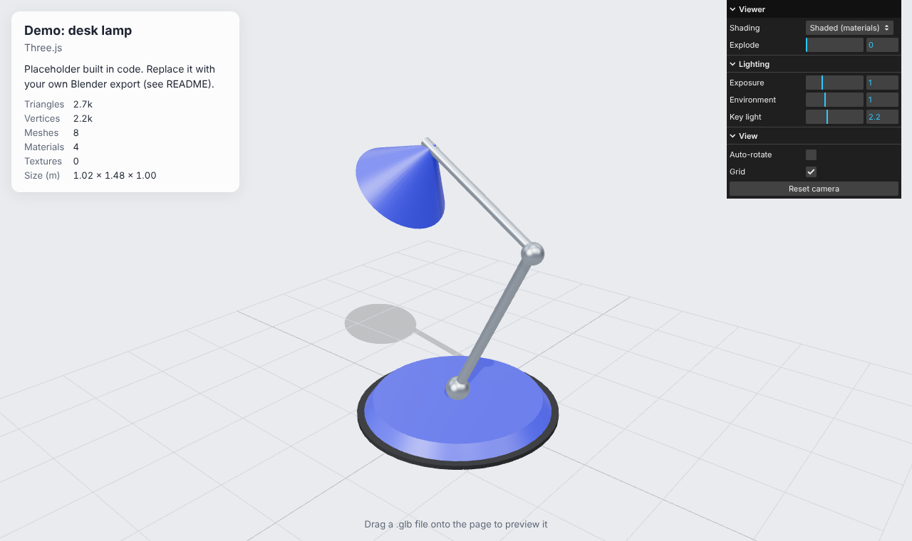
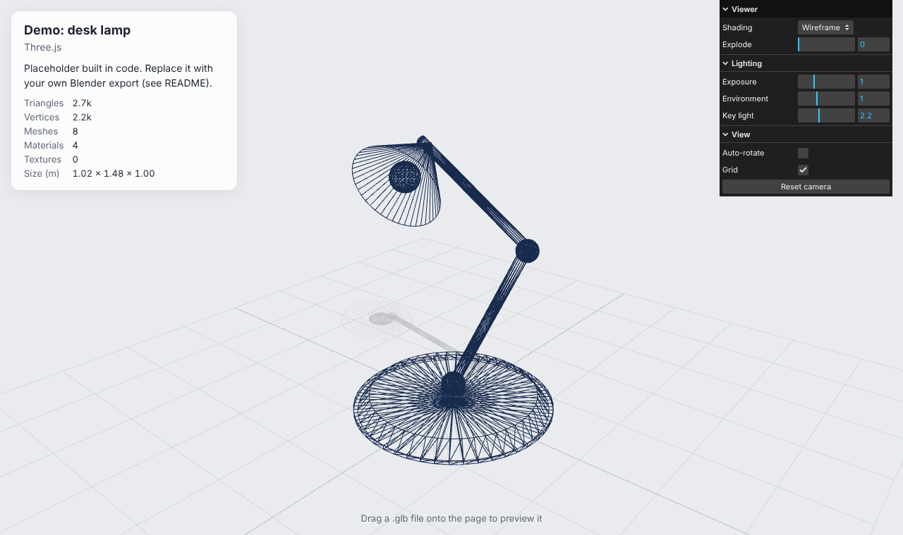
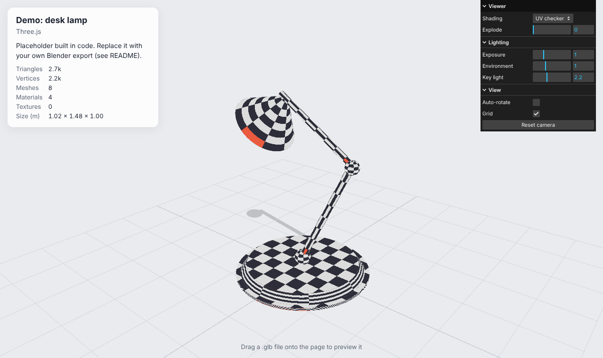
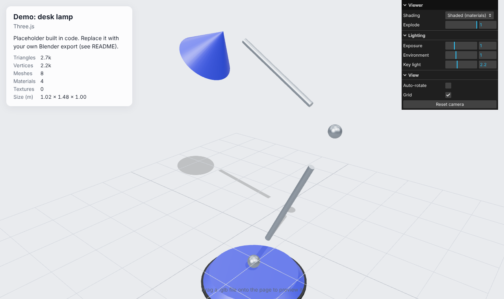

# Blender Web Viewer

[](https://github.com/mochiquin/blender-web-viewer/actions/workflows/ci.yml)

An interactive browser viewer for 3D models made in Blender, built with **TypeScript**, **Three.js** and **Vite**.
Drop in a `.glb` export and inspect it the way you would in Blender's viewport: orbit around it,
switch shading modes, explode it into parts and check its polygon budget.

**Live demo:** https://mochiquin.github.io/blender-web-viewer/ (published by GitHub Actions on every push to `main`)

| Shaded | Wireframe |
| --- | --- |
|  |  |
| **UV checker** | **Exploded view** |
|  |  |

## Features

- **glTF / GLB loading** with Draco and Meshopt compression support, decoded locally (no CDN)
- **Drag and drop**: drop any `.glb` onto the page to preview it; the file never leaves your computer
- **Shading modes** like Blender's viewport: materials, clay, wireframe, normals and a UV checker
- **Exploded view** slider that pulls parts away from the centre, correct even under scaled parents
- **Hover and select** parts by name, with a Blender-orange selection box
- **Model budget stats**: triangles, vertices, meshes, materials, textures and real-world size
- **PBR lighting**: image-based lighting, ACES tone mapping and soft shadows, adjustable live
- **Light on resources**: pixel ratio capped at 1.5, rendering paused in hidden tabs, GPU memory freed on model swap

## Getting started

Requires Node.js 20 or newer.

```bash
npm install
npm run dev        # http://localhost:5173
```

## Adding your own Blender model

1. In Blender: **File → Export → glTF 2.0**, format **glTF Binary (.glb)**.
   - Include: *Selected Objects* if you only want part of the scene.
   - Mesh: tick *Apply Modifiers*.
   - Compression: tick it to use Draco (smaller files; supported here).
   - Use **Principled BSDF** materials; most other shader nodes do not export to glTF.
2. Put the file in `public/models/`, e.g. `public/models/lady-maria.glb`.
3. Add an entry to `src/projects.ts`:

   ```ts
   {
     id: 'lady-maria',
     title: 'Lady Maria',
     description: 'Character look-dev: hand-painted PBR textures in Substance Painter.',
     file: 'lady-maria.glb',
     tools: ['Blender', 'ZBrush', 'Substance 3D Painter'],
   },
   ```

4. With more than one entry a **Model** dropdown appears in the panel. Link to a model directly with `?model=lady-maria`.

**Keep web models light.** Aim for under ~10 MB and a few hundred thousand triangles. Decimate or
retopologise sculpts and bake detail into normal maps, and use 1K–2K textures (WebP or KTX2).

## Project structure

```
src/
  main.ts              wires the page together: loading, info card, drag and drop
  projects.ts          the list of portfolio models
  viewer/
    Viewer.ts          renderer, scene, lights, camera, controls, hover/select, render loop
    loadModel.ts       GLTFLoader with Draco + Meshopt decoders
    framing.ts         fit the camera to a model's bounding sphere
    explode.ts         exploded-view offsets in each part's parent space
    viewModes.ts       swap materials for clay / wireframe / normals / UV checker
    modelStats.ts      triangle, vertex, material and texture counts
  ui/
    panel.ts           lil-gui control panel
    dropzone.ts        drag-and-drop file handling
  demo/demoModel.ts    placeholder model built in code
tests/                 unit tests (Vitest)
e2e/                   browser tests (Playwright, real WebGL in Chromium)
```

## Testing

```bash
npm test           # unit tests: framing, explode, view modes, stats, project catalogue
npm run test:e2e   # builds the site and drives it in Chromium: loads the demo, switches
                   # shading modes, drops a real .glb fixture, rejects non-model files
```

Both run in GitHub Actions on every push and pull request, along with a TypeScript type check.

## Deployment

`.github/workflows/pages.yml` builds the site and publishes it to GitHub Pages on every push to `main`.
To turn it on once: repository **Settings → Pages → Source: GitHub Actions**.

## Roadmap

- [ ] Replace the demo with my own Blender and ZBrush work
- [ ] Turntable mode and camera bookmarks
- [ ] Material inspector: show each texture map of the selected part
- [ ] Before/after slider for Cycles → Octane material conversions
- [ ] Custom GLSL shader showcase

## License

Code is MIT licensed (see `LICENSE`). Models added to `public/models/` keep their own licences.
