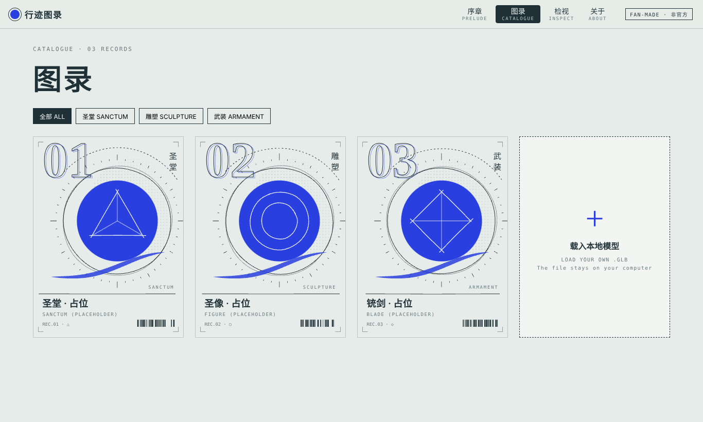
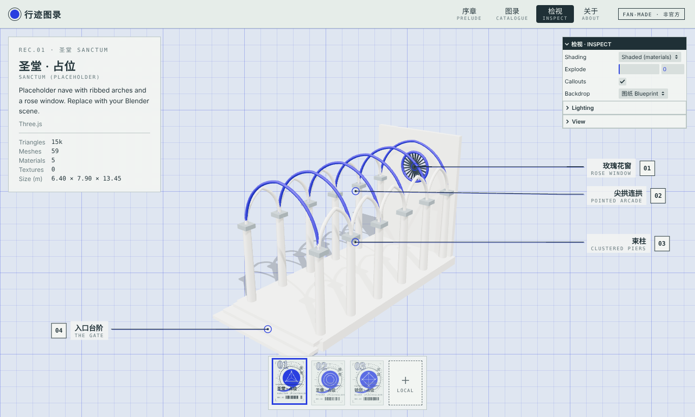
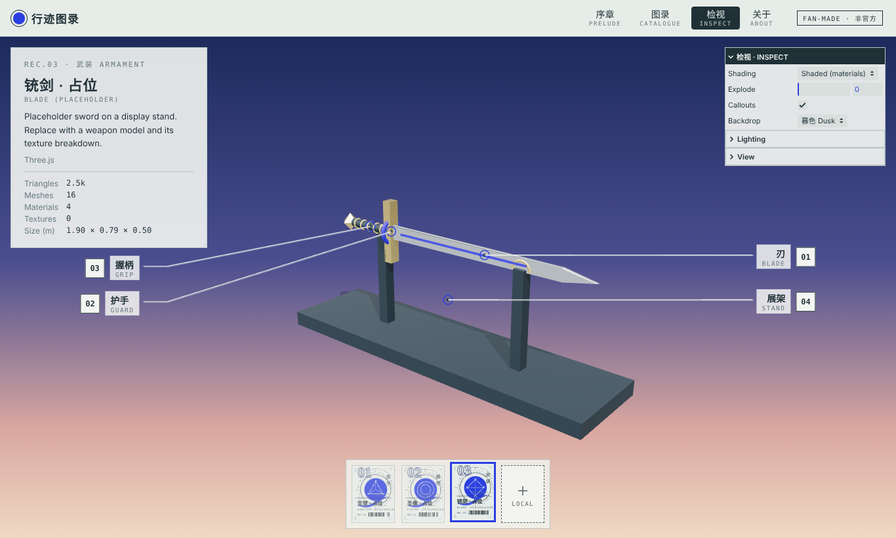

# 行迹图录 · Travels, a fan 3D archive

[](https://github.com/mochiquin/blender-web-viewer/actions/workflows/ci.yml)

A fan-made, interactive 3D archive inspired by the graphic design of *Arknights*' "众生行记" event:
cobalt discs, halftone, hand-drawn rings and catalogue plates. It presents sanctums, sculptures and
weapons as 3D models you can orbit, explode and annotate, built with **TypeScript**, **Three.js** and **Vite**.

> Fan-made and non-commercial. Not affiliated with or endorsed by Hypergryph.
> All models and graphics in this repository are original work; see [Assets](#assets).

**Live site:** https://mochiquin.github.io/blender-web-viewer/

| Prelude | Catalogue |
| --- | --- |
|  |  |
| **Inspect: sanctum (blueprint backdrop)** | **Inspect: blade (dusk backdrop)** |
|  |  |

The models shown are placeholders built in code; they will be replaced with Blender and ZBrush work.

## Rooms

| Room | What it does |
| --- | --- |
| 序章 Prelude | Hero poster drawn in SVG: cobalt disc, halftone, ring inscription, flock; layers drift with the pointer |
| 图录 Catalogue | One generated plate per entry, filterable by category (圣堂 / 雕塑 / 武装) |
| 检视 Inspect | 3D viewer with leader-line callouts, backdrops, shading modes, exploded view and model stats |
| 关于 About | Author, tools and the fan-work disclaimer |

Drop a `.glb` anywhere on the site (or use **载入本地模型**) to inspect your own model. The file is
opened in the browser and never uploaded.

## Features

- **Callouts that follow the camera**: each annotated part gets a ring and an elbow leader line out to
  a label column, laid out so labels never overlap or hide behind panels
- **Generated graphics**: plates and the hero are drawn from a seeded "hand-drawn" vocabulary
  (wobbling rings that overshoot, bowed rules, tapered brush strokes), so they look the same every load
- **Backdrops**: paper, blueprint grid, halftone sun and dusk, set per entry or switched live
- **Shading modes** like Blender's viewport: materials, clay, wireframe, normals, UV checker
- **Exploded view** that stays correct under scaled parents (common in Blender exports)
- **Budget check**: triangle count and estimated texture memory; heavy models get a warning and shadows off
- **glTF / GLB** with Draco and Meshopt compression, decoded locally
- **Light on resources**: WebGL starts only when the inspect room opens and pauses when you leave it;
  pixel ratio capped at 1.5; GPU memory freed when switching models

## Getting started

Requires Node.js 20 or newer.

```bash
npm install
npm run dev        # http://localhost:5173
```

## Adding an entry

1. In Blender: **File → Export → glTF 2.0**, format **glTF Binary (.glb)**.
   Tick *Apply Modifiers*; tick *Compression* for Draco. Use Principled BSDF materials.
   **Name your objects** in the Outliner: callouts point at objects by name.
2. Put the file in `public/models/`, e.g. `public/models/sanctum.glb`.
3. Edit the entry in `src/projects.ts`:

   ```ts
   {
     id: 'sanctum',
     number: '01',
     title: '拉特兰圣堂',
     titleEn: 'SANCTUM OF LATERANO',
     category: 'cathedral',            // 'cathedral' | 'sculpture' | 'weapon'
     description: 'Gothic nave modelled in Blender, textures in Substance 3D Painter.',
     tools: ['Blender', 'Substance 3D Painter'],
     file: 'sanctum.glb',              // replaces the built-in placeholder
     backdrop: 'blueprint',            // 'paper' | 'blueprint' | 'halftone' | 'dusk'
     annotations: [
       { part: 'Rose window', label: '玫瑰花窗', note: 'ROSE WINDOW' },  // part = Blender object name
     ],
   },
   ```

Site titles, links and the disclaimer live in `src/site.ts`.

**Keep web models light:** under ~10 MB and a few hundred thousand triangles; 1K–2K textures
(WebP or KTX2). Retopologise sculpts and bake detail into normal maps.

## Assets

Everything committed here is original. If you add third-party images (for example official game
graphics), put them in `public/assets/third-party/`: that folder is git-ignored so it is never
published from this repository. Credit them on the About page.

## Project structure

```
src/
  main.ts                 room router, global drag and drop
  site.ts                 titles, links, disclaimer
  projects.ts             catalogue entries, categories, backdrops
  router.ts               hash routes (#/catalogue, #/inspect/<id>, ...)
  rooms/                  prelude, catalogue, inspect, about
  graphics/
    sketch.ts             seeded hand-drawn SVG primitives
    plates.ts             catalogue plates and hero poster
  scenes/                 placeholder sanctum, sculpture and weapon built in code
  ui/
    annotations.ts        leader-line callouts that track the camera
    labelLayout.ts        callout placement (no overlaps, clear of panels)
    panel.ts              lil-gui inspect panel
    dropzone.ts           drag and drop
  viewer/
    Viewer.ts             renderer, lights, camera, hover/select, pause/resume
    loadModel.ts          GLTFLoader with Draco + Meshopt
    framing.ts            fit the camera to a model
    explode.ts            exploded-view offsets
    viewModes.ts          clay / wireframe / normals / UV checker
    modelStats.ts         triangles, textures, budget warnings
tests/                    unit tests (Vitest)
e2e/                      browser tests (Playwright, real WebGL in Chromium)
```

## Testing

```bash
npm test           # 77 unit tests: graphics, plates, layout, router, scenes, explode, stats
npm run test:e2e   # 11 browser tests: every room, every preset, panel controls, drag-and-drop,
                   # file chooser, rejected files, phone layout
```

Both run in GitHub Actions on every push and pull request, with a TypeScript type check.

## Deployment

`.github/workflows/pages.yml` publishes the site to GitHub Pages on every push to `main`.
Enable it once in **Settings → Pages → Source: GitHub Actions**.

## License

Code is MIT licensed (see `LICENSE`). Models in `public/models/` keep their own licences.
*Arknights* and related names are trademarks of their respective owners.
